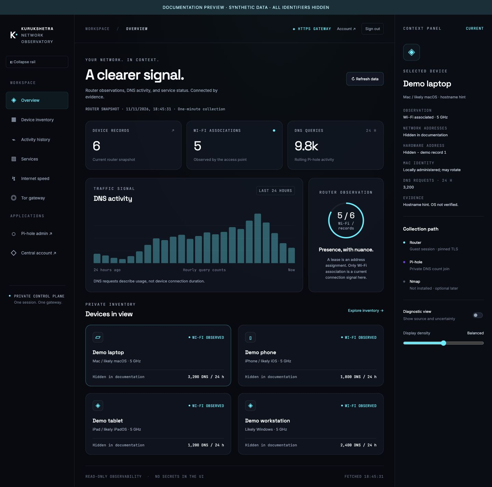
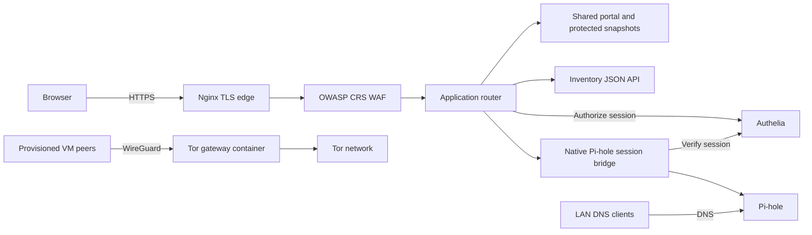
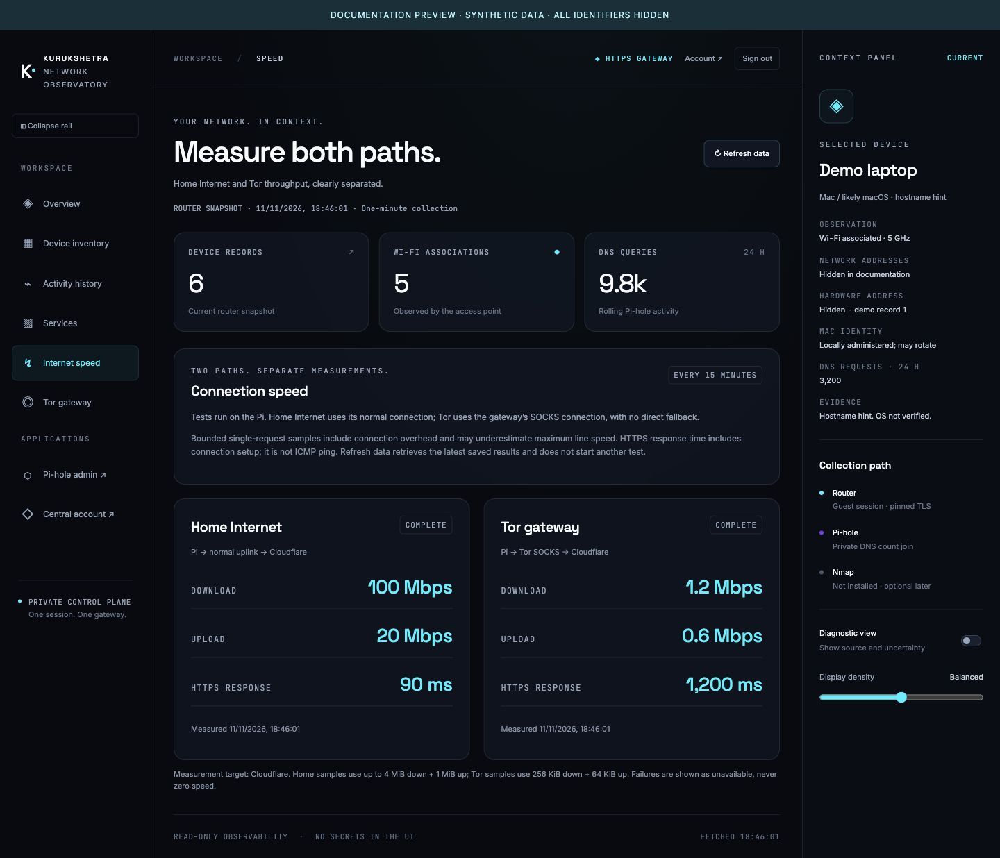

# Kurukshetra-Ops

A Raspberry Pi operations stack with Pi-hole DNS filtering, one authenticated HTTPS portal, private network observations, a containerized WireGuard/Tor gateway and optional monitoring.

## Dashboard



*Documentation preview using the real UI and synthetic data. Device names, addresses, hardware identifiers, exit IPs and measurements do not come from the live lab.*

The shared portal provides inventory, rolling DNS activity, service state, Tor client guidance and separate home/Tor speed samples. Every application page, API and download requires the same central session. The old standalone detailed-inventory page has been removed.

## Architecture at a glance



The only published web listener is HTTPS. DNS, SSH recovery and WireGuard are necessary non-web protocols. Internal identity, inventory, WAF and bridge listeners are not published on the host. Use the configured hostname; direct IP web access and HTTP are rejected.

- [Architecture and network boundaries](docs/ARCHITECTURE.md)
- [Collection and dashboard data flow](docs/networking/DATA-FLOW.md)
- [Login, shared session, Pi-hole integration and logout](docs/security/AUTHENTICATION.md)
- [Gateway security controls and operations](docs/security/GATEWAY.md)

## Deployment

Run commands from the repository root on the Pi. One `docker-compose.yml` defines all services. Pi-hole is the default; `gateway`, `tor`, `inventory`, `observability` and `monitoring` are optional profiles. Profiles start selected services but do not stop containers already running.

Before starting a profile, prepare its private configuration. The ignored `.env` supplies the stable site address and Pi-hole password. Gateway identity and router guest credentials are entered locally using the documented helpers. Certificates must cover the configured hostname and be trusted by clients. Tor requires a separately provisioned private WireGuard configuration. Never store credentials in Git or command arguments, and do not regenerate existing identity encryption keys.

For an already provisioned stack:

```bash
./deploy.sh --gateway --tor --inventory --prepare --configure-only
./deploy.sh --gateway --tor --inventory up -d --build
./deploy.sh --gateway --tor --inventory ps
./deploy.sh --gateway --tor --inventory logs --tail 30
```

`--prepare` creates missing runtime directories and the Pi-hole log file; it does not reset ownership or rewrite addresses. Setup, private configuration, profile selection and safe maintenance are detailed in [operations](docs/OPERATIONS.md). Optional monitoring has separate resource/configuration requirements and is not enabled by these commands.

## Chitragupt and observability

The portal includes a read-only Chitragupt summary. The optional Grafana/Prometheus/Alloy stack charts host resources, service runtime, anonymous bot registry counts and home/Tor samples through the same login. No direct monitoring ports are published. Real bot heartbeat, application tracing and log collection are not implemented.

- [Chitragupt integration](docs/integrations/CHITRAGUPT.md)
- [Observability architecture, setup and validation](docs/observability/README.md)
- [Lightweight operational log events](docs/observability/LOGS.md)

## Data and operational limits

Router observations are polled every minute and retained privately for a rolling 24 hours. A DHCP lease is not proof a device is online. Wi-Fi association and DNS activity are distinct signals. Device types are hostname hints, not verified OS fingerprints; private MAC rotation and address reassignment limit attribution. Failed or stale collection is shown explicitly.

Home Internet and Tor measurements run every 15 minutes. They are bounded throughput samples from the Pi, not the viewing device or a maximum ISP line-speed test. Browser refresh reads cached results and cannot trigger arbitrary commands or external targets.



*Example measurements only; no real connection speeds or network identity are exposed in this image.*

## Documentation

| Area | Guide |
| --- | --- |
| Operations and layout | [Operations](docs/OPERATIONS.md) |
| Authenticated inventory | [Private inventory](docs/networking/PRIVATE-INVENTORY.md) |
| DNS aggregates | [DNS activity](docs/networking/DNS-ACTIVITY.md) |
| Home/Tor measurements | [Connection speed](docs/networking/CONNECTION-SPEED.md) |
| Tor gateway | [Gateway setup and limitations](docs/networking/TOR-GATEWAY.md) |
| Ubuntu / Windows peers | [Ubuntu](docs/networking/UBUNTU-TOR-CLIENT.md) · [Windows](docs/networking/WINDOWS-TOR-CLIENT.md) |
| Host hardening and recovery | [Hardening](docs/security/HOST-HARDENING.md) · [Wi-Fi SSH recovery](docs/networking/WIFI-SSH-RECOVERY.md) |
| UI and privacy-safe captures | [Design system](docs/ui/DESIGN-SYSTEM.md) · [Screenshot workflow](docs/ui/SCREENSHOTS.md) |
| Repository privacy | [Repository hygiene](docs/REPOSITORY-HYGIENE.md) |

Secrets, real site settings, keys, certificates, runtime state and implementation plans remain ignored. Saved JSON is indented and newline-terminated. No scanner/Nmap enrichment, role hierarchy or mTLS is currently implemented. Browser profiles use ordinary installed browsers and do not add Tor Browser’s anti-fingerprinting protections.

## Verification

```bash
.venv-router/bin/python scripts/monitoring/test-router-inventory.py
.venv-router/bin/python scripts/monitoring/test-network-speed.py
python3 scripts/monitoring/test-dns-activity.py
python3 tests/gateway/verify-edge.py
```

The gateway check makes non-mutating local HTTPS requests, verifies authentication and origin restrictions, and checks retired web ports. Secrets remain local. Mocked tests and successful probes are not a substitute for broader security testing; platform, reboot and optional-profile limits are recorded in their guides.
