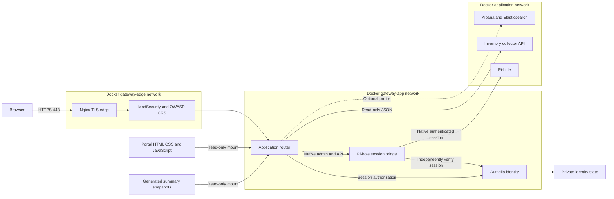
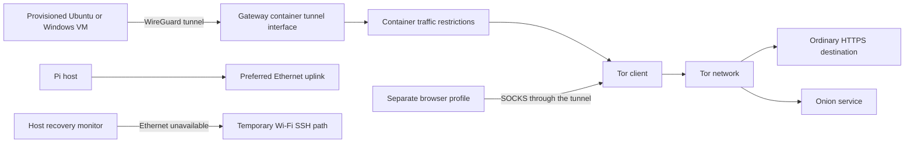

# Architecture

Kurukshetra-Ops separates authenticated web access, DNS filtering, Tor transport and host recovery. Diagrams describe the checked-in Compose topology and collectors; they use logical service names, never site addresses or account identities.

## Web gateway and application boundaries

The subgraphs show service membership and trust boundaries, not independent copies. WAF belongs to both gateway networks; the application router and bridge also join the application network. Identity is internal. The edge strips client-supplied identity headers; the application router and bridge ask the provider whether the current session is valid.

| Entry point | Purpose | Exposure |
| --- | --- | --- |
| HTTPS 443 | Portal, login, APIs and application views | Only published web listener |
| DNS TCP/UDP 53 | Pi-hole filtering | Necessary non-web LAN protocol |
| WireGuard UDP 51820 | Provisioned VM peers | Necessary non-web tunnel endpoint |
| SSH | Operator access and repair | Host service, outside Compose gateway |
| Inventory, identity, WAF and bridge | Internal backend listeners | No published host web port |

HTTP 80 and the former direct inventory port are closed. The canonical configured hostname is required; a direct IP web request is rejected. Nginx only receives the leaf server certificate/key, not the CA private key. Docker membership does not remove the need for authorization.

## Tor and network recovery

The Pi hosts the Tor client and WireGuard gateway in a container; it is not a public exit relay. Ordinary browsers use a separate proxy-configured profile for onion access. Tor supports the configured TCP-oriented path, not arbitrary UDP. Existing fail-closed rules and client validation limits are documented in the platform guides. Tor use does not make signed-in accounts or browser fingerprints anonymous.

Host Ethernet/Wi-Fi recovery is a separate systemd service. Wi-Fi is a repair path when Ethernet fails, not automatic continuity for services bound to an Ethernet address. Do not infer container or VM state from the recovery monitor alone.

## Deployment and storage

- `docker-compose.yml`: one service definition with `gateway`, `tor`, `inventory` and `monitoring` profiles. Pi-hole is the default service; profiles do not stop already-running containers.
- `config/portal/www/`: canonical shared UI assets. The former standalone inventory HTML/CSS/JavaScript page has been removed.
- `config/gateway/templates/`: reviewed edge, WAF and router templates. Generated private runtime configuration is ignored.
- `scripts/monitoring/`: status/DNS collectors, inventory contracts and collection, bounded throughput samples.
- `data/identity/`: private provider database and local state. `data/router-inventory/`: private 24-hour observation store, current snapshot and renewable router session.
- `config/nginx/www/`: generated allowlisted snapshots and client downloads; protected by the gateway even when their contents are anonymous summaries.
- Certificates, credentials, site configuration, runtime history and implementation plans stay outside Git. Saved JSON uses two-space indentation and a trailing newline.

The optional bot uses a separate Compose project and is not managed by this repository’s deployment command. Certificate provisioning is a lifecycle task; a certificate job need not run continuously. Optional monitoring has not been included in every end-to-end validation checkpoint.

See [data flow](networking/DATA-FLOW.md), [authentication flow](security/AUTHENTICATION.md), [gateway controls](security/GATEWAY.md) and [operations](OPERATIONS.md).
