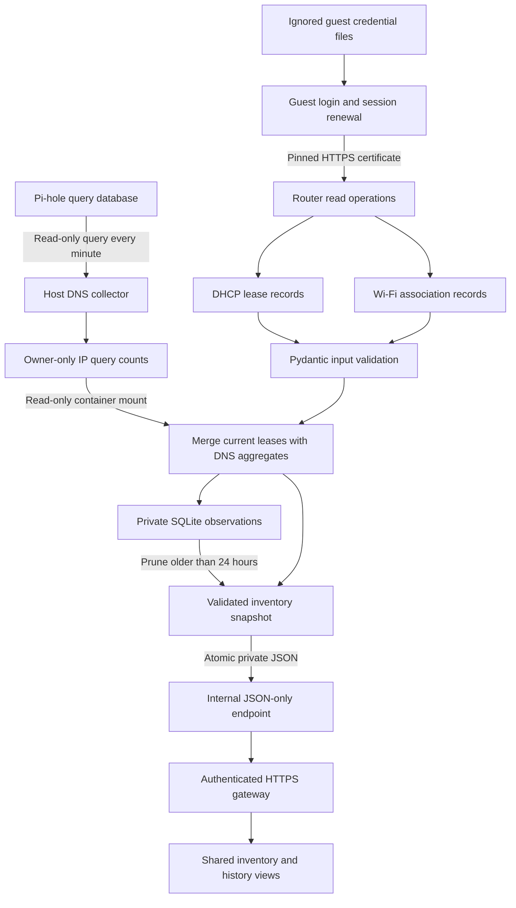
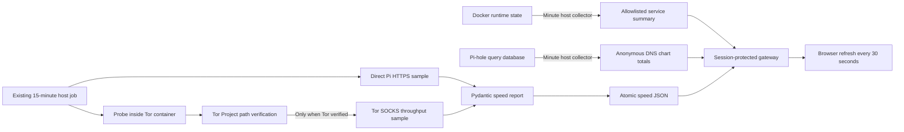

# Data flow and freshness

## Router observations and DNS join

The collector polls every minute under normal conditions. It does not capture every connection event. A DHCP lease is an address assignment, not proof that a device is online. Only the router’s Wi-Fi association signal is presented as observed association. Hostnames provide type hints; no OS fingerprint scan runs. Private MAC rotation can split identities, and changing address ownership can misattribute DNS counts. History begins when collection starts; first observed is not an authoritative join time.

Raw names, addresses and hardware identifiers remain in private state and are shown only after portal login. Rejected credentials pause renewal until the local secret changes; transient failures use bounded backoff. Certificate-pin changes fail closed. Old observations remain historical evidence, while failed collection is marked unavailable/stale rather than falsely reporting every device disconnected.

## Service status and throughput

Collectors use existing operator Docker access; no Docker socket is mounted into a browser-facing service. Browser requests read saved results and cannot submit arbitrary targets, start commands or launch bandwidth tests. Home and Tor samples remain separate. The direct sample measures the Pi’s normal uplink, not the viewing device’s Wi-Fi. Tor verification must succeed before Tor speed values can be published. There is no direct-network fallback for a failed Tor test.

| Signal | Normal collection | Freshness in portal | Meaning |
| --- | --- | --- | --- |
| Router inventory | Every minute | Stale after 3 minutes | Last router observation, not guaranteed presence |
| DNS and service summary | Every minute | Stale after 3 minutes | Persisted DNS usage and runtime signals |
| Home/Tor speed | Every 15 minutes | Stale after 20 minutes | Bounded throughput sample, not ISP maximum speed |
| Browser refresh | Every 30 seconds while visible | Reads the saved timestamp | Does not itself collect network data |

A speed request is bounded by bytes and time. HTTPS response time includes connection and application overhead; it is not ICMP ping. Throughput may be underestimated by the small sample sizes. See [measurement methodology and traffic caps](CONNECTION-SPEED.md).

## Screenshots and documentation privacy

Documentation images are generated from real portal assets with synthetic fixtures. No production snapshot, router cookie, password, device name, address, hardware identifier, exit IP or private profile is loaded into that preview. A visible synthetic-data banner prevents the images being mistaken for live measurements. See [safe screenshot workflow](../ui/SCREENSHOTS.md).
