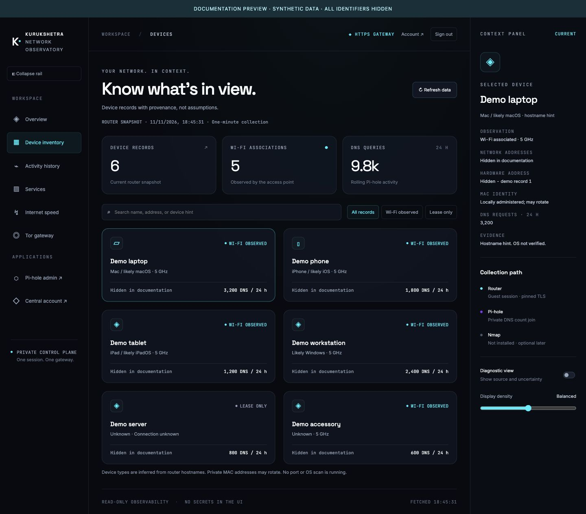

# Private network inventory

## Purpose and boundaries

The optional `inventory` Compose profile polls the Jio router every minute and joins current IP leases with Pi-hole DNS counts. It stores a rolling observation history and serves a private, read-only dashboard. Router names provide hints about device types; they do not verify an operating system. Wi-Fi association is distinct from a DHCP lease. Polling can miss brief connections. First observed is not the actual join time. Private MAC rotation can produce new identities, and IP reassignment can misattribute historical DNS counts.

## Project layout

- `scripts/monitoring/router_inventory/`: Pydantic contracts, router adapter, repository, collector and runtime scheduler.
- `scripts/monitoring/configure-router-secrets.py`: interactive local credential setup.
- `scripts/monitoring/serve-private-inventory.py`: allowlisted private HTTP routes.
- `containers/router-inventory/`: image build definition. Additional build contexts copy canonical source and UI assets; no duplicated source and no private configuration in the image.
- `config/router-inventory/local.json`, `container.json`, `secrets/`: ignored local settings and owner-only secret files.
- `data/router-inventory/`: ignored private SQLite observations, snapshot and renewable session.
- `data/dns-activity/`: ignored private DNS counts published by the existing host status job; mounted read-only into the collector.

## Setup and start

On the Pi, configure the reviewed router address and SHA-256 certificate pin in the private local settings. Keep file mode 600 and the configuration directory mode 700. Then:

```bash
python3 scripts/monitoring/configure-router-secrets.py
./deploy.sh --inventory up -d --build router-inventory
./deploy.sh --inventory ps router-inventory
```

The local setup command prompts twice for the guest password, sets guest as the only supported login identity, and writes the runtime UID/GID to the private .env. Passwords must never be passed in CLI arguments, environment values, Git, or chat. Compose file-backed secrets are restricted local files, not an encrypted vault. Updating credentials requires recreating the container so bind-mounted secret files are refreshed.

The earlier host cron collector has been removed. The container owns its polling loop; do not install both schedules. The existing public status cron remains responsible for public DNS summaries and a separate private DNS count export. No Docker socket or full Pi-hole configuration directory is mounted into the inventory container.

## Protected access

Open the configured HTTPS gateway hostname, sign in once and select Device inventory. The separate legacy HTML/CSS/JavaScript page has been removed. Only the authenticated `/inventory/inventory.json` data feed remains; `/inventory/` returns 404. Inventory has no published host port; the former loopback SSH-forward workflow is retired. All snapshots and downloads are protected by centralized login. mTLS is not yet implemented. See [gateway security](../security/GATEWAY.md).

## Authentication and failure handling

The collector follows the observed preLogin, login, postLogin sequence, requires a GUEST response, and retains the resulting cookie/token privately. It checks an exact, previously reviewed router certificate fingerprint before transmitting credentials or session headers and refuses changed certificates. It does not follow redirects or fall back to unpinned requests.

On an unauthorized read, one renewal is attempted, then reads are retried. Rejected credentials or another unauthorized response pause renewal until the password secret is changed; this avoids a repeated bad-password loop. Other network failures use bounded backoff. The dashboard marks failed or old snapshots stale rather than reporting all devices offline. Previous observations remain available as historical evidence. Signing out affects viewing, not background collection.

## Verification and operations

```bash
.venv-router/bin/python scripts/monitoring/test-router-inventory.py
python3 scripts/monitoring/test-dns-activity.py
./deploy.sh --inventory logs --tail 20 router-inventory
./deploy.sh --inventory stop router-inventory
```

Tests cover schema rejection, redacted secrets, certificate mismatch before session transmission, private-file permissions, merge semantics, and failure-state preservation. Live checks cover guest login, polling, DNS joins, private HTTP routes and simulated expired-session renewal. Natural long-duration expiry and reboot remain separate follow-up checks. No Nmap component is installed; enrichment is a later optional phase.

Rollback: stop the single inventory service. Public DNS summaries and the existing Pi-hole/Tor/gateway services continue. Keep private state if history is needed; remove secret files only when retiring the integration. Do not enable the old host cron while the container runs.

## Data-flow reference and documentation preview

See [collection flow](DATA-FLOW.md) for validation, DNS joins, retention and freshness. The image below uses synthetic fixtures with identifiers hidden; no production records were used.


