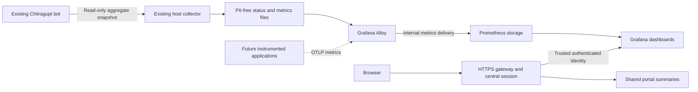

# Observability design and rollout

## Design decision

Use a local metrics-first stack: **Grafana** for visualization, **Prometheus** for time-series storage and **Grafana Alloy** as the OpenTelemetry-compatible collector. This avoids enabling the heavier optional Elasticsearch/Kibana stack for metrics. Loki log storage and Tempo trace storage are later, separate phases. The first stage does not ingest raw bot logs, Telegram updates, messages, names, user IDs, chat IDs, bot URLs or credentials.

The Pi has four CPU cores, about 3.7 GiB total RAM and about 2.8 GiB available at assessment, with approximately 99 GiB free storage. The configured memory ceilings total 1152 MiB: Grafana 512 MiB, Prometheus 384 MiB and Alloy 256 MiB. An initial runtime sample measured approximately 525 MiB combined; usage changes with queries and history. This is a planning budget, not a performance guarantee. Start with low-cardinality metrics, 60-second sampling, short retention and a storage-size target that leaves room for Prometheus WAL/head data.



## Chitragupt integration

Chitragupt already runs as a separate Compose project with long polling and no local HTTP API. Keep that lifecycle unchanged and never start a second poller. The first dashboard integration reads aggregate counts inside the existing container as its application user. Only bounded, validated summaries leave it. It does not call Telegram, send messages, mutate users or roles, expose tokens, mount a Docker socket into a web service, or copy its databases into this repository.

Expose runtime state, uptime/restarts, registered identity counts, registered chat counts, role-level distribution and schema availability. Container running is distinct from application healthy: the bot does not currently provide a successful-poll heartbeat, so Telegram connectivity and request latency must remain unknown. Bot log polling alone must not be treated as a proof of connectivity.

## Authentication and isolation

Grafana is reached only through the existing HTTPS gateway and central session, under a subpath. Use Grafana’s supported auth-proxy mechanism with the gateway overwriting the trusted identity header after authorization. All valid portal users get equal read-only dashboard access. Disable anonymous access, independent login UI and external signup; no second user login is required. No direct host port is published for Grafana, Prometheus, Alloy or OTLP. Keep the collector and storage internal and use a dedicated Docker network.

Provision dashboards/data sources from reviewed files. Browser access does not grant Docker control, arbitrary shell commands, Telegram administration or broad metrics target configuration. A valid Grafana session alone must not bypass the central authorization check, including API and asset routes. Central logout therefore denies later Grafana requests at the gateway.

## Privacy and signal quality

Keep metric labels bounded: service name, state, configured role level and known chat category. Never use user/chat IDs, names, message text, arbitrary URLs, exception strings or bot tokens as labels or span attributes. Telegram bot credentials appear in request URL paths, so generic automatic HTTP instrumentation is unsafe without explicit sanitization. Future application instrumentation must emit safe operation names and success/latency counters, with identifiers removed before export.

Use current, stale and unavailable states explicitly. Historical charts describe sampled observations, not guaranteed uptime or a complete audit trail. Registry counts are not active Telegram membership counts. Alert delivery and Telegram notifications are not enabled by this stage.

## Rollout status

Design was documented before deployment as requested. The metrics-only stack is now deployed. Chitragupt summaries refresh through the existing minute job; Alloy scrapes once per minute and Grafana refreshes once per minute. Prometheus retains three days of samples with a 1 GB block-retention target; WAL/head data can exceed that target. Raw log storage, traces and outbound alerts remain out of scope. A separate [lightweight operational event viewer](LOGS.md) is available in the portal.

Verified: shared portal login, Viewer-only access with no initial Grafana administrator, anonymous-route rejection, rejected identity-header spoofing from an untrusted internal network, closed direct host ports, stored host/container/bot series, and a synthetic OTLP metrics probe. The probe also checked removal of identifiers, resource/scope metadata, metric units and exemplars, and rejection of unapproved metric names. This validates the collector pipeline, not real bot instrumentation. Chitragupt still has no application heartbeat or emitted OTLP metrics.

The bot remained running without a restart or a second Telegram poller. The application router was restarted to attach the isolated networks. No new host port was published.

## Primary references

- [OpenTelemetry Collector architecture](https://opentelemetry.io/docs/collector/architecture/)
- [Grafana Alloy overview](https://grafana.com/docs/alloy/latest/introduction/why-alloy/)
- [Grafana trusted proxy authentication](https://grafana.com/docs/grafana/latest/setup-grafana/configure-access/configure-authentication/auth-proxy/)
- [Prometheus storage and retention limits](https://prometheus.io/docs/prometheus/latest/storage/)

## Operations

From the repository root on the Pi, provision private settings once, then start the optional profile:

```bash
python3 scripts/security/configure-observability.py
./deploy.sh --gateway --observability up -d
python3 scripts/monitoring/verify-observability.py
# Optional synthetic OTLP privacy probe; does not contact Telegram:
python3 scripts/monitoring/verify-observability.py --probe
```

The configuration helper preserves an existing signing key, renders the configured portal origin into ignored dashboards, and derives the narrow trusted proxy subnet from the internal gateway network. A one-shot initialization service sets ownership only on the three new Docker-managed volume roots. It does not repair host permissions. Secrets and rendered site settings stay under ignored `config/observability/private/`.

Open `/grafana/` through the central portal. Source dashboard JSON is provisioned read-only; edit the reviewed source and republish with `scripts/monitoring/publish-observability.py`, then restart Grafana to pick up changes immediately. Do not expose Grafana, Prometheus, Alloy, or OTLP using host port mappings.

To stop just this optional stack without deleting historical data:

```bash
docker compose stop grafana prometheus alloy
```

The existing host minute job continues publishing bounded snapshots. Named volumes preserve history across container restarts; deleting them deletes history. The older `monitoring` profile is separate and is not required for this stack.

## Validation commands

```bash
.venv-router/bin/python scripts/monitoring/test-chitragupt.py
.venv-router/bin/python scripts/monitoring/test-observability.py
python3 tests/gateway/verify-edge.py
```

See [Chitragupt integration](../integrations/CHITRAGUPT.md) for interpretation and privacy limits.

## Lightweight log events

The portal Logs view uses a bounded, sanitized file collector without adding Loki or another database. See [scope, privacy and retention](LOGS.md). Grafana continues to show metrics; raw messages are available only through local diagnostics.
