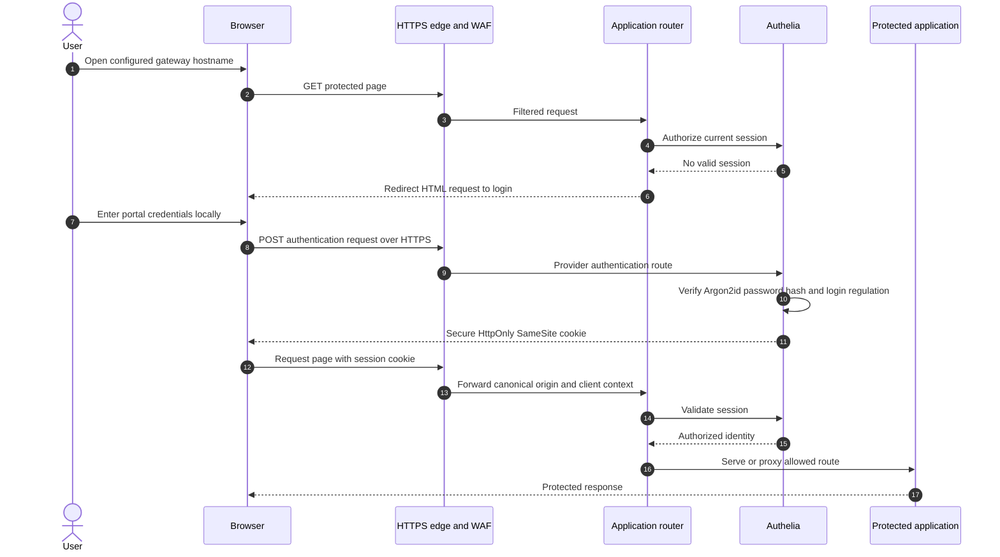
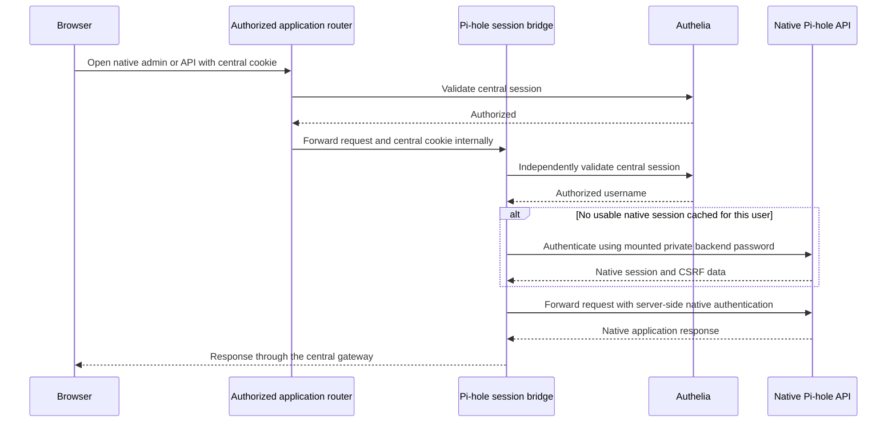
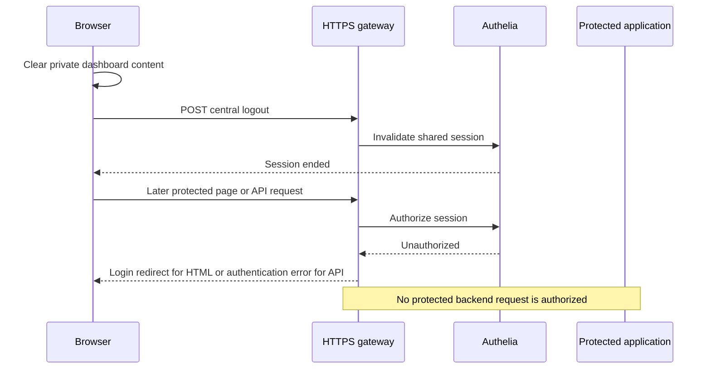

# Centralized authentication and session flow

One Authelia login gates every application page, snapshot, download and API behind the HTTPS gateway. All valid portal users currently have the same access; separate RBAC and mTLS are not implemented. The provider’s login assets and necessary authentication API remain reachable so users can authenticate; these routes do not expose application inventory.

## Login and authorized requests

Anonymous JSON/API requests receive an authentication error instead of a misleading login document. An unavailable provider fails closed. Client-supplied identity headers are stripped at the edge; a claimed username is not accepted as proof of authentication. Application write paths require the configured same Origin, while the provider handles its own authentication/session protections. WAF method exceptions are exact Pi-hole operations, not a gateway-wide permission change.

The configured session has a 30-minute inactivity timeout and an eight-hour absolute lifetime. Login regulation limits repeated failed passwords. Passwords are chosen locally; the portal stores an Argon2id hash rather than plaintext. Provider session/storage secrets and state are private, ignored runtime files. A file-backed Compose secret is not an encrypted vault. Do not regenerate a storage key against an existing encrypted provider database.

## Pi-hole without a second user login

Pi-hole’s native password authentication remains enabled. The bridge does not forward the central cookie to Pi-hole or send the backend password to the browser. Cached native sessions remain server-side; every bridge request still needs central authorization. A native authentication failure is retried once with a renewed native session; persistent failure returns unavailable. Direct backend web ports are not published.

## Logout, expiry and failure

The portal revalidates when returning from browser history and clears private data on an authentication failure. Central logout was verified to block both the portal and native Pi-hole. Pi-hole’s separate backend logout action is replaced by the central session flow; it is not another independent login boundary.

For controls, exact WAF exceptions, configuration and validation limits, see [gateway security and operations](GATEWAY.md). For topology, see [architecture](../ARCHITECTURE.md). These diagrams document implemented controls and known boundaries; they are not an assertion of complete OWASP compliance.
