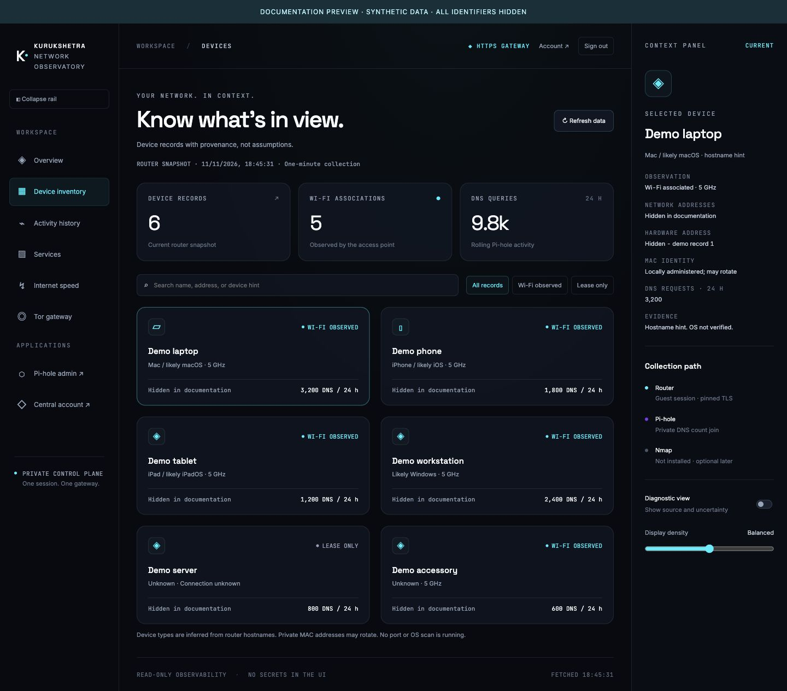

# Privacy-safe dashboard screenshots

The documentation screenshots use the real portal HTML/CSS/JavaScript with synthetic fixtures. They are not redacted copies of a production screenshot: live data never enters the capture environment. A visible banner identifies the preview, and captions identify example measurements. This avoids missed identifiers in cards, context panels, tooltips or browser history.

## Reproduce

From a checkout with the portal assets:

```bash
python3 scripts/documentation/preview-dashboard.py --port 8877
```

Open the loopback preview in a browser, select Overview, Device inventory or Internet speed, and capture the page. Stop the preview when finished. It binds only to loopback and serves an exact allowlist of UI assets and generated fixtures. It cannot read production snapshots, private configuration, router sessions, keys or observation databases. No Docker or router access is used. It is an unauthenticated demonstration server, not a deployable alternative to the real gateway; never publish its port.

## Capture checklist

- Keep the synthetic-data banner visible. All numbers and names are examples, never copied lab observations.
- Network and hardware identifiers display `Hidden in documentation`; no actual IP, MAC, hostname, account or exit address is loaded.
- Capture the page content rather than browser chrome, account menus, developer tools, terminals or notifications.
- Do not add production screenshots, cookies, token files, private profiles, logs or metadata dumps to `docs/assets/`.
- Review the full image at readable scale, including the context panel and bottom of long pages.
- Store approved JPEGs in `docs/assets/` with descriptive lowercase names. Update alt text and captions with the same privacy statement.

## Approved views

- `dashboard-overview.jpg`: summary cards, DNS chart, sample devices and context.
- `dashboard-inventory.jpg`: searchable synthetic inventory.
- `dashboard-speed.jpg`: separate home/Tor sample cards with example values.

Provider authentication is documented using sequence diagrams rather than publishing a real sign-in session or account details. The preview’s authentication links are nonfunctional placeholders and do not demonstrate production session security. See [authentication flow](../security/AUTHENTICATION.md) for the actual implementation.

## Gallery



*Real portal layout with demo records. No production device names, addresses or account identifiers were loaded.*
